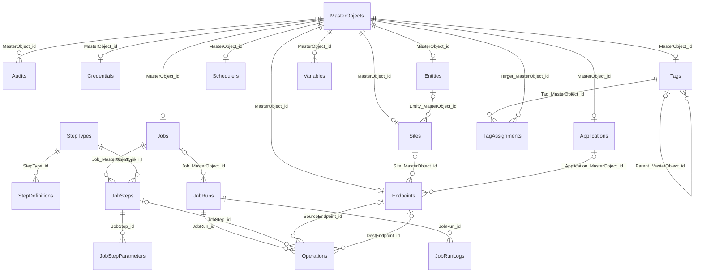
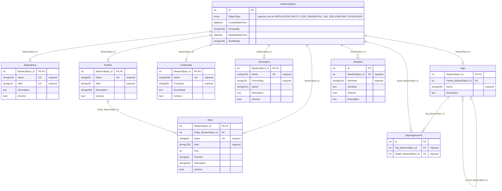
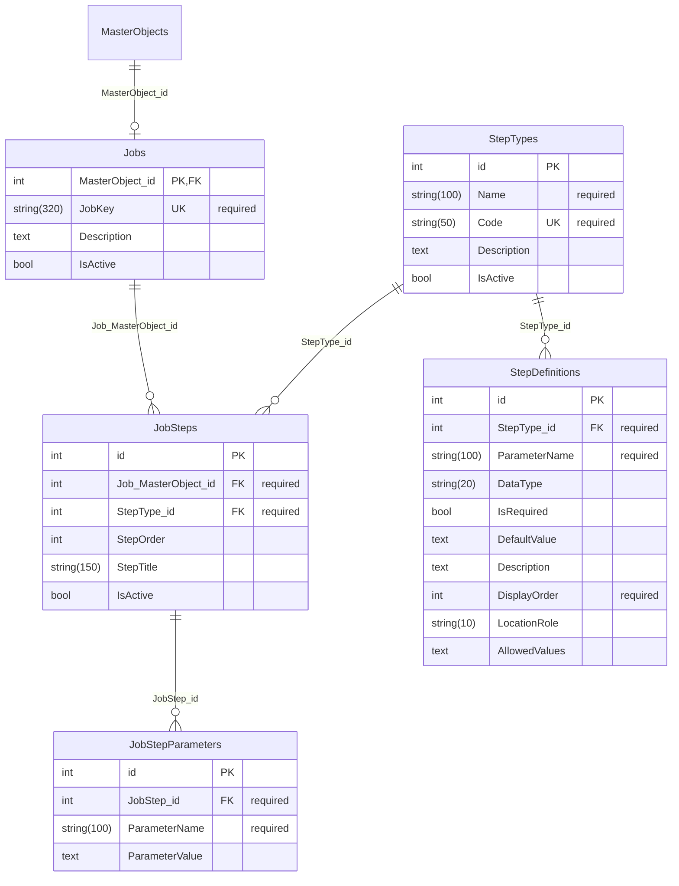
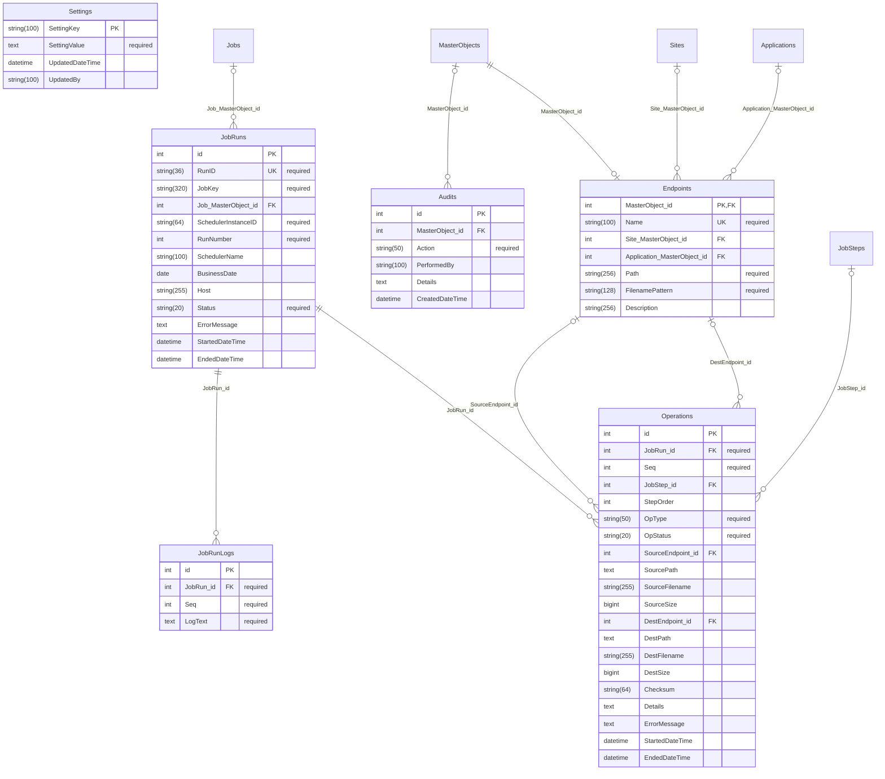

# Database Schema

_Generated from `autoapp/app/models.py` by `docs/generate_diagrams.py`. Do not edit by hand; change the models and run the script._

This is the schema the Python models create. The MariaDB script `SQL/Create_Tables.sql` is generated from the same models by `SQL/generate_ddl.py`.

## Reading the diagrams

- `PK` primary key, `FK` foreign key, `UK` unique.
- A line ending in a crow's foot is the "many" side. The label is the foreign key column.
- `Applications`, `Entities`, `Sites`, `Credentials`, `Tags`, `Jobs` and `Endpoints` each share their primary key with one row in `MasterObjects`.

## Overview

All tables and how they connect.

## Domain registry

## Jobs and steps

## Endpoints, runs, operations, audits and settings

## Multi-column unique constraints

| Table | Columns that must be unique together |
| :--- | :--- |
| `Tags` | `Parent_MasterObject_id`, `Name` |
| `Variables` | `MasterObject_id`, `VarName` |
| `TagAssignments` | `Tag_MasterObject_id`, `Target_MasterObject_id` |
| `JobRunLogs` | `JobRun_id`, `Seq` |
| `Operations` | `JobRun_id`, `Seq` |
