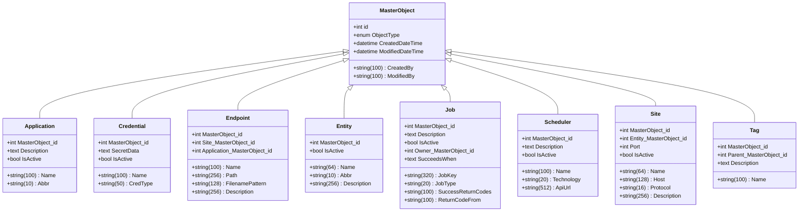
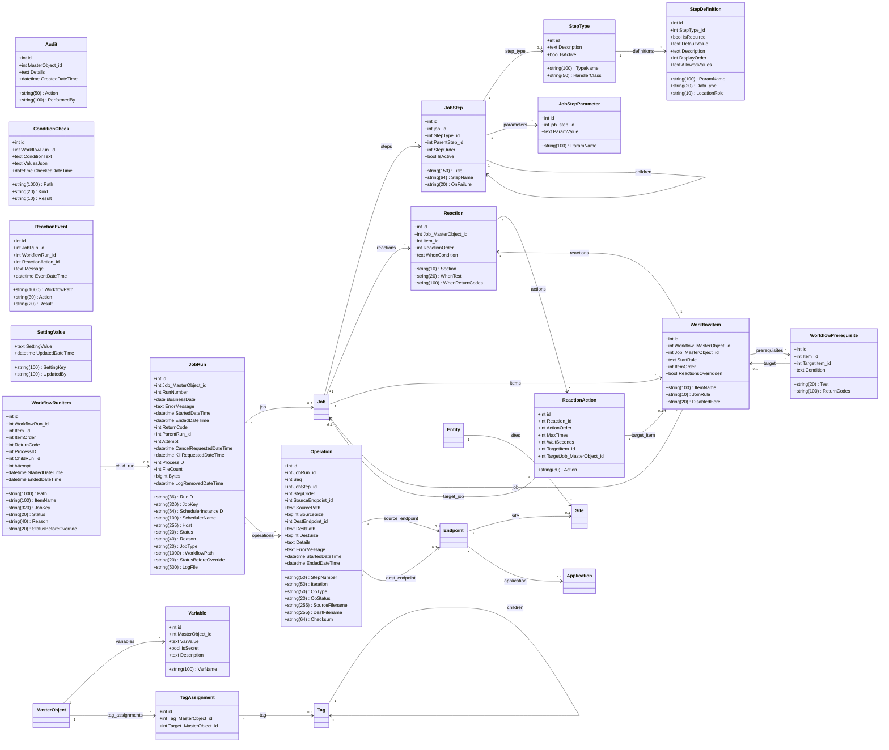
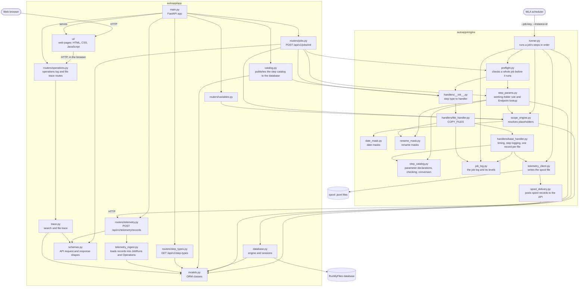

# Python Model

_Generated from `autoapp/app/models.py` by `docs/generate_diagrams.py`. Do not edit by hand; change the models and run the script._

Two views: the ORM classes in `autoapp/app/models.py`, and how the Python modules depend on each other. The module diagram is written by hand inside the generator script.

## ORM classes: inheritance

The domain classes inherit from `MasterObject`. Each subclass shows only the attributes it adds; it also has everything `MasterObject` has.

## ORM classes: supporting classes and relationships

An arrow is a relationship attribute you can follow in code: `job.steps` is the list of a job's `JobStep` objects. The label is the attribute name.

Relationships created in the other direction (for example `job_step.job`) exist too but are not drawn.

## Where the Python name differs from the column name

Use the Python name in code and the column name in SQL.

| Class | Python attribute | Database column |
| :--- | :--- | :--- |
| `JobStep` | `job_id` | `JobSteps.Job_MasterObject_id` |
| `JobStep` | `Title` | `JobSteps.StepTitle` |
| `JobStepParameter` | `job_step_id` | `JobStepParameters.JobStep_id` |
| `JobStepParameter` | `ParamName` | `JobStepParameters.ParameterName` |
| `JobStepParameter` | `ParamValue` | `JobStepParameters.ParameterValue` |
| `StepDefinition` | `ParamName` | `StepDefinitions.ParameterName` |
| `StepType` | `TypeName` | `StepTypes.Name` |
| `StepType` | `HandlerClass` | `StepTypes.Code` |

## Modules

An arrow means "uses".

